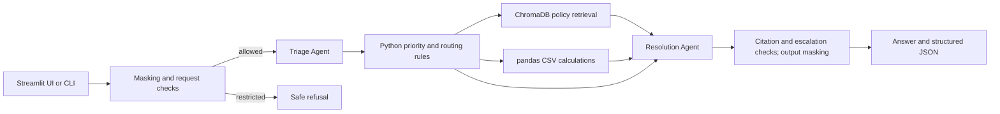

# Retail Operations Copilot

A local Streamlit and command-line assistant for retail issue triage, policy guidance, and a small set of CSV analytics questions. It recommends actions for human review; it does not issue refunds, contact vendors, change records, or execute other business actions.

## Architecture



There are exactly two LLM agents. The **Triage Agent** identifies the category, intent, entities, scope, and proposed priority. Python checks identifiers and applies the priority and escalation rules. The **Resolution Agent** receives the verified context, retrieved policy sections, and calculated CSV facts, then drafts the response. Both agents use the OpenRouter model set in `.env` through [`llm.py`](retail-copilot-simple/llm.py).

Policy Markdown is split by heading and indexed in an in-memory ChromaDB collection. Local, deterministic 384-dimensional hashed-term vectors avoid an embedding service or model download. This is primarily lexical retrieval, so paraphrased requests may miss relevant sections. pandas reads the supplied CSVs directly; CSV rows are not put in ChromaDB. A policy citation is accepted only when its section was retrieved.

| Component | File | Responsibility |
| --- | --- | --- |
| UI | [`streamlit_app.py`](retail-copilot-simple/streamlit_app.py) | Local browser form and structured result |
| Orchestration and CLI | [`app.py`](retail-copilot-simple/app.py) | Shared `run_query` workflow, priority, evidence, escalation |
| Agents | [`agents/`](retail-copilot-simple/agents) | Triage and resolution prompts and JSON validation |
| Policy search | [`tools/policies.py`](retail-copilot-simple/tools/policies.py) | ChromaDB indexing, retrieval, citation sources |
| Data | [`tools/data.py`](retail-copilot-simple/tools/data.py) | CSV filtering, joins, counts, and routes |
| Safety | [`tools/safety.py`](retail-copilot-simple/tools/safety.py) | Restricted-request checks and masking |
| Evaluation | [`evaluate.py`](retail-copilot-simple/evaluate.py) | Public-case predictions and metrics |

## Input data and supported work

The supplied files remain in [`data/`](data/): five policy Markdown files in `data/knowledge_base/`, nine operational CSVs in `data/data/`, and the public evaluation files in `data/evaluation/`. The app reads these folders in place. It can also read the same three folders placed inside `retail-copilot-simple/` if the application is moved elsewhere. Do not copy credentials or evaluation labels into model prompts.

Supported intents include inventory issues, vendor shortages, unresolved P1/P2 case summaries, product quality trends, policy questions, and routine store issues. Priority rules use the supplied guide and verified evidence: store-wide payment failures and active safety risks are P1; impactful shortages and repeated quality problems are generally P2; isolated device or pricing problems are generally P3; general questions and reporting requests are P4. Unclear scope prompts a follow-up. Escalation routes come from `escalation_matrix.csv`; an unverified route is reported as unconfirmed.

The analytics anchor required by the guide is **10 October 2026, 12:00 IST**. The last 24 hours means `(9 October 2026, 12:00, 10 October 2026, 12:00]`. `Open` and `In Progress` cases count as unresolved. Missing records remain unknown. Short receipts indicate quantity gaps, not proven root causes.

Restricted data requests and explicit instruction overrides are refused before an LLM call. Recognizable emails, Indian phone numbers, card patterns, and simple secrets are masked. These checks are heuristic. Human review is required for P1 handling, recalls, refund overrides, vendor claims, and restricted access. Confidence is a heuristic score, not a calibrated probability.

## Run locally

Use Python 3.10 or newer. From the repository root in PowerShell:

```powershell
cd retail-copilot-simple
python -m venv .venv
.\.venv\Scripts\Activate.ps1
python -m pip install -r requirements.txt
if (-not (Test-Path .env)) { Copy-Item .env.example .env }
```

Set `OPENROUTER_API_KEY` and an exact compatible `OPENROUTER_MODEL` ID in `retail-copilot-simple/.env`. Keep `OPENROUTER_BASE_URL=https://openrouter.ai/api/v1`. The `.env` file is ignored by Git. If it already exists locally, edit it rather than overwriting it. Restart the app after changing the model.

```powershell
python -m streamlit run streamlit_app.py --server.address 127.0.0.1
```

Open <http://127.0.0.1:8501>. Stop a foreground server with Ctrl+C. The UI shows the answer, priority, escalation, citations, CSV provenance, and full JSON result. It keeps only the masked result in the current Streamlit session.

For command-line queries and evaluation:

```powershell
python app.py --query "Card reader on register 4 is failing, but others work."
python app.py --query "Show unresolved P1 and P2 incidents from the last 24 hours grouped by store."
python evaluate.py
```

The CLI prints a readable response and structured JSON with `category`, `priority`, `confidence`, `answer`, `citations`, `data_used`, `escalation`, `pii_masked`, `follow_up_question`, and `safety_refusal`.

## Evaluation

`python evaluate.py` reads the public cases and prediction schema, then writes [`predictions.csv`](retail-copilot-simple/outputs/predictions.csv) and [`metrics.csv`](retail-copilot-simple/outputs/metrics.csv). The public evaluation run on 10 October 2026 produced:

| Metric | Result |
| --- | ---: |
| Category accuracy | 11/11 |
| Priority accuracy | 11/11 |
| Policy citation presence | 10/10 policy answers |
| Citation validity | 11/11 cited answers |
| Public safety refusal | 1/1 |
| Public PII masking | 1/1 |
| Data-use correctness proxy | 5/5 |

The data-use proxy verifies that a relevant CSV was used; it does not establish that every answer is correct. Answer quality requires human review. The demo handles the named analytics intents and recommends human-approved actions; it is not a general database query or production authorization system.
