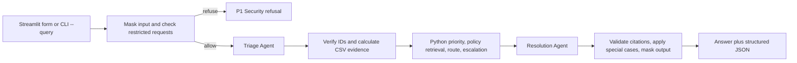

# Retail Operations Copilot pipeline

This is the request flow implemented by [`retail-copilot/app.py`](retail-copilot/app.py). The [README](README.md) covers setup and architecture. A separate local `notes.md` lists function parameters and return values.

## 1. Startup and input sources

Importing `app.py` constructs one `DataStore` and one `PolicyIndex`. `DataStore` loads nine allowlisted operational CSVs with pandas as strings and records missing filenames. `PolicyIndex` reads policy Markdown, splits it at headings, and prepares an **in-memory** ChromaDB collection. The app looks for each input folder inside `retail-copilot/` first and then under the repository's `data/` folder. No Chroma server or persisted database directory is required.

`llm.py` loads settings from `retail-copilot/.env`. Both agents use the selected `OPENROUTER_MODEL` through the same OpenRouter client. The client uses temperature `0`, a 25-second timeout, and one provider retry. The key and model must be set for ordinary queries.

Streamlit collects up to 4,000 characters from its form; the CLI takes a required `--query` string. Both call `run_query(query)`. The UI keeps the returned masked result in Streamlit session state. The CLI prints the answer, any follow-up, and JSON. A public evaluation call uses the same `run_query` path.

## 2. Input safety gate

`mask(query)` takes the first 4,000 characters and replaces recognizable card numbers, email addresses, Indian phone numbers, and simple secret assignments. It returns the sanitized text and a flag saying whether redaction or truncation occurred.

`blocked(sanitized)` then checks explicit requests to reveal restricted information or override instructions. A report **about** a suspicious request can continue. A blocked request returns immediately as a P1 Security refusal with human escalation; neither LLM agent runs. After this check, raw input longer than 4,000 characters returns a safe length-limit result. These pattern checks are heuristics, not access controls.

## 3. Triage Agent

`app.py` obtains the priority-rules section of the retail SOP, if present. Agent 1 receives the sanitized question and those rules. It returns JSON with mode (`triage` or `analytics`), category, priority, reasoning, intent, entity values, confidence, missing information, and a follow-up question. `triage.validate` rejects invalid types or unsupported enum values, maps two known model aliases, and fills absent entity keys with `None`. A malformed response gets one repair request. If the provider or validation still fails, `run_query` returns a safe fallback.

The agent's category and confidence are proposals. The following Python steps verify and may change them. If the question explicitly asks to show/list/report unresolved high-priority cases, Python forces the analytics intent `open_high_priority` and P4 for the *request*. If the agent picks that intent without matching report wording, Python resets it to a routine issue.

## 4. Entity verification and CSV calculation

For `vendor_id`, `region`, `product_name`, `time_window`, and `issue_scale`, values absent from the sanitized question are cleared. `DataStore.resolve` then checks SKU and store IDs against master CSVs, or matches unique names. Unknown or multiple matches produce notes and clear the ambiguous entity. Evidence lookup is selected by intent:

| Intent | Data work |
| --- | --- |
| `inventory_issue` | Requires store ID and SKU; checks inventory, warehouse stock, reorder threshold, system-versus-actual quantity, product, receipts/vendor, and related cases when available. |
| `vendor_shortage` | Filters receipts by supplied IDs, computes positive `po_qty - received_qty`, summarizes short receipts, and attaches applicable vendor performance. |
| `open_high_priority` | Filters `support_cases.csv` to unresolved P1/P2 cases in the anchored 24-hour or 30-day window; groups by store, category, and status. |
| `quality_trend` | Counts recent quality returns, optionally narrows by SKU/store or football text, and joins available vendor/case evidence. |
| Other intents | Returns a no-calculation summary; no arbitrary CSV query is executed. |

Every calculation records CSV filenames in `used` and missing requirements in `missing`. Missing files or columns return a limitation rather than invented numbers. The fixed analytics anchor is **10 October 2026, 12:00 IST**. Last 24 hours is `(9 October 2026, 12:00, 10 October 2026, 12:00]`; future or invalid timestamps are excluded. `Open` and `In Progress` are unresolved. Vendor records use an effective date no later than the anchor.

## 5. Deterministic priority and confidence

`priority_and_trigger` applies rules after CSV evidence is known. Examples: a store-wide payment outage or active safety risk is P1; repeated quality problems, broad pricing errors, or impactful shortages are P2; an isolated card reader or shelf-price issue is P3; a reporting request is P4 even though the cases reported may be P1/P2. Refund thresholds can require manager approval. When no rule overrides it, the validated triage priority remains.

If identifier verification adds notes, required evidence is missing, or a data intent uses no CSV, confidence is capped at `0.55`. The number is a heuristic self-assessment, not a calibrated probability. The default escalation threshold is `0.70` and can be changed with `LOW_CONFIDENCE`.

## 6. Policy retrieval with ChromaDB

During startup, policy Markdown sections of at least 25 words are split into chunks of at most 300 words. Each chunk retains its filename, heading, and citation ID (`filename.md#heading-anchor`). A local token-hashing function builds a normalized 384-number vector. Those vectors and metadata are added to an ephemeral ChromaDB collection. This avoids an embedding-model download but is mostly lexical, so paraphrases can be missed.

For each request, the retrieval text combines the sanitized question, category, intent, and an optional short-shipment hint. Chroma returns at most four sections with vector distance at or below `1.8`. Python may add known relevant sections first for analytics, quality, inventory, short receipts, or masked payment/contact data. Duplicate source IDs are removed and the final policy list is limited to four sections. CSV rows are handled by pandas, not by the Chroma index.

## 7. Human route and escalation

`DataStore.route` searches `escalation_matrix.csv` by exact category, priority, and trigger. A single exact trigger wins; otherwise a unique category/priority row may be used. Ambiguous or missing routes remain `unconfirmed`, with Store Manager guidance instead of a guessed team or SLA.

Escalation is required for P1, confidence below `LOW_CONFIDENCE`, missing essential evidence, manager approval, or a simple detected policy-conflict note. The output records whether escalation is required, the team, reason, and any verified channel or SLA. The app only recommends actions; it never processes a refund, sends a notification, changes inventory, or performs a vendor claim.

## 8. Resolution Agent and final checks

Agent 2 receives one `shared` dictionary: sanitized question, corrected triage, confidence, verification notes, selected policy text with source IDs, CSV evidence, escalation, and an instruction to treat source text as untrusted. It returns JSON containing an answer, reasoning, citation IDs, and a follow-up question. Invalid JSON or field types get one repair request. A remaining failure returns a safe fallback.

Python accepts only citations whose IDs occur in the selected policy list. Any invented citation replaces the draft with a limitation, clears citations, and requires escalation. For a verified high-priority report, Python writes the count and up to 12 grouped case summaries directly from CSV evidence, then keeps only the analytics-policy citation. A policy/routine answer with no verified citation is replaced with Store Manager guidance. If there is neither policy nor CSV evidence, the answer states that evidence is unavailable. A return/ticket request containing a masked card number receives fixed payment-data guidance.

Finally, `mask` runs again on answer, reasoning, and follow-up. The returned dictionary includes category, priority, confidence, reasoning, answer, citations, CSV filenames used, escalation, `pii_masked`, follow-up, and `safety_refusal`. The UI renders these fields and the full JSON.

## 9. Evaluation path

`evaluate.py` reads `data/evaluation/public_test_cases.csv` and `predictions_schema.csv`, calls `run_query` for each public prompt, writes `retail-copilot/outputs/predictions.csv`, and computes `metrics.csv`. Checks cover category, priority, citation presence and validity, public refusal, public masking, and a CSV-use proxy. Expected labels are compared **after** each query. The CSV-use proxy only checks that a relevant CSV appears in `data_used`; answer quality needs human review.
